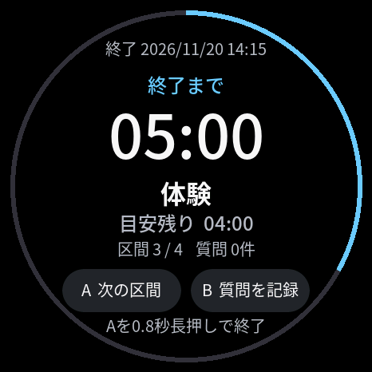

# Tour Pacer for M5Stack StopWatch

区間の目安と終了時刻を振動で知らせる、施設案内用のタイマーです。

`m5stopwatch-tour-pacer` は、M5Stack StopWatch（C152）用のArduinoスケッチです。案内はStopWatch単体で行えます。コースを変更するときは、本体のWi-Fiに接続したスマートフォンやPCを使います。

終了日時を固定した全体タイマーと、各区間に入った時点から計る目安タイマーを独立して動かします。終了時刻を過ぎても記録を続け、Aの長押しで終了します。質問は発生時点だけを記録し、録音や所要時間の推定はしません。



PC上の自動テスト31件とM5StopWatch向けビルドを確認しました。Wi-Fiへの接続とタッチ操作は実機での確認待ちです。[検証記録](VERIFICATION.md)・[設計仕様 v0.2](stopwatch-tour-guide-spec.md)

## Arduino IDEで開く

1. Arduino IDEの追加ボードマネージャURLに、次の公式URLを登録します。

   ```text
   https://static-cdn.m5stack.com/resource/arduino/package_m5stack_index.json
   ```

2. ボードマネージャでM5Stackを、ライブラリマネージャでM5UnifiedとM5GFXを導入します。次の組み合わせでArduino CLI 1.6.0による対象ボード向けビルドを確認しました。

   | 要素 | ビルド確認済みバージョン |
   |---|---|
   | M5Stackボードパッケージ | 3.3.7 |
   | M5Unified | 0.2.28 |
   | M5GFX | 0.3.0 |
   | ボード選択 | `M5StopWatch` |

   ボード指定・最低要件は[公式ボタン例](https://docs.m5stack.com/en/arduino/stopwatch/button)、M5Unified 0.2.28とM5GFXの依存条件は[公式リリース](https://github.com/m5stack/M5Unified/releases/tag/0.2.28)を参照しています。

3. [StopWatchTourGuide/StopWatchTourGuide.ino](StopWatchTourGuide/StopWatchTourGuide.ino) を開き、`M5StopWatch`を選択します。16 MB Flashと8 MBのOPI PSRAMを使用します。ボードの既定設定を基本とし、PSRAMを無効にしないでください。
4. 「検証」でコンパイルしてから、接続先ポートを選んで書き込みます。

同じスケッチフォルダの `partitions.csv` は、16 MiB Flash用にNVS領域を84 KiB確保します。2つの保存スロットを併存させるための設定です。Arduinoの標準の書き込み先（アプリ `0x10000`、OTAデータ `0xe000`）を維持し、NVSを `0xc10000` に置きます。初回導入時はパーティション配置が以前のファームウェアと変わります。以前のファームウェアの保存データを引き継ぐ用途には使わないでください。本プログラムの記録を残したい更新では、この配置を変更しないでください。

## CLIでビルドする

Bash、Python 3、Arduino CLIを用意し、リポジトリのルートで次を実行します。セットアップで取得するパッケージとライブラリは、リポジトリ内の `.arduino/` に保存します。

```sh
./scripts/setup-arduino.sh
./scripts/build-board.sh
```

CLIがPATHにない場合は、先に `export ARDUINO_CLI="$HOME/bin/arduino-cli"` のように実際のインストール先を指定します。

セットアップはM5GFXとM5Unifiedの両方を固定バージョンで指定し、依存関係の自動解決によるバージョン変更を防ぎます。

ビルドスクリプトは `arduino-cli board listall` から名称が `M5StopWatch` のM5Stackボードを選びます。該当ボードがなければ停止します。別のESP32ボードへの置き換えは行いません。

成功時のファームウェアは `build/firmware/`、実際に使用したCLI・ボードパッケージ・ライブラリのバージョンは `build/board-versions.txt`、ビルドログは `build/board-build.log` に出力します。`.arduino/data` がない場合はCLIの既存設定を使います。スクリプトは端末への書き込みを行いません。

コンパイル後には `scripts/verify-firmware.py` が、生成されたパーティション表と結合画像内のアプリ・ブートローダー・OTAデータの配置を照合します。結果は `build/firmware-check.log` に出力します。`StopWatchTourGuide.ino.merged.bin` は初回書き込み用の全体画像です。全体画像を書き込むとNVSの保存記録も消えるため、記録を残す更新にはArduino IDEの通常の書き込み、または次のスクリプトを使ってください。

## CLIで端末に書き込む

Linuxでの手順です。端末をダウンロードモードでUSB接続し、ビルド後に次を実行します。`/dev/ttyACM0` は実際の接続ポートに置き換えてください。

```sh
./scripts/upload-board.sh /dev/ttyACM0
```

書き込みスクリプトはビルドと同じ `.arduino/` を参照し、生成済みファームウェアを検査してから書き込みます。ソースを変更した場合は先に `./scripts/build-board.sh` を実行してください。書き込みログは `build/board-upload.log` に保存します。

書き込み後はUSBをつないだままにしてください。端末が起動すると、スクリプトがPCの現地日時を秒まで内蔵時計に設定します。「時刻同期完了」と表示された日時は、端末から読み戻して確認した値です。自動で起動しない場合は、同期を待っている間に電源ボタンを短く1回押してください。同期後はUSBを外して使えます。

電源ボタンを2回押して電源を切った後も内蔵時計が進むように、起動時に時計と加速度センサーへの給電を保持する設定（L1）を有効にします。待機中も本体バッテリーを少し使います。バッテリーが切れて時計が止まった場合は、充電後に再同期してください。[M5Stackの電源管理ガイド](https://docs.m5stack.com/en/arduino/stopwatch/m5pm1_m5ioe1)

時刻だけを合わせ直すときや、Arduino IDEから書き込んだときは、端末を通常モードの待機画面にして、PCで次を実行します。

```sh
python3 scripts/sync-clock.py /dev/ttyACM0
```

`arduino-cli upload` を直接実行すると、CLIの通常の設定によっては `.arduino/` が参照されず、`Platform 'm5stack:esp32' not found` になります。このリポジトリのセットアップで導入した場合は、上記スクリプトを使ってください。

## 端末で使う

1. 待機画面で現在日時を確認します。手動で合わせるときは「現在」をタップし、「年」「月」「日」「時」「分」を選んで「−」「＋」で変更します。手動で「確定」すると秒は00になります。
2. 「終了時刻を設定」で案内の締切を確定します。初期候補は現在の分から15分後です。翌日に終わる案内は「日」も選んでください。
3. 「案内を開始」をタップするか、黄色のAを0.8秒長押しします。中央の数字と外周のリングが全体の残り時間を示します。「次の区間」と「質問を記録」は、画面のタップ、またはA・Bの短押しで操作できます。
4. どの区間でもAを0.8秒長押しすると終了して保存します。振り返りでは「次の区間」またはAでページを進めます。質問が4件以上ある区間では上下にスワイプします。「待機に戻る」またはBで待機画面に戻ります。

保存に失敗したときは「再保存」をタップします。保存が成功するまで今回の結果を画面に保持します。再保存前に電源を切ると今回の結果は失われますが、直前の正常な記録は別スロットに残ります。

30秒操作しないと画面を減光します。減光中も計時・入力・振動を続け、ボタンやタッチ操作で明るさを戻します。減光解除のために押したボタンも通常の操作として受理します。

## Wi-Fiでコースを設定する

1. StopWatchの待機画面で「コース配分」→「Wi-Fiで設定」をタップします。本体に接続先・パスワード・URLが表示されます。
2. スマートフォンまたはPCのWi-Fi設定で、表示された `M5StopWatch-xxxx` を選び、8桁のパスワードを入力します。「インターネット接続なし」と表示された場合も、そのまま接続を続けてください。
3. ブラウザーで `http://192.168.4.1` を開きます。コース名、区間名、各区間の目安時間を編集できます。時間は「分」「秒」のどちらか一方だけでも、両方を組み合わせても入力できます。「＋ 区間を追加」「削除」で区間数を変え、矢印で案内順を変えます。「振動予告」では、全体の終了時刻や各区間の目安まで、あと何分何秒で振動するかを指定します。
4. 「本体に保存」を押し、「本体に保存しました」と表示されたら、StopWatchで「Wi-Fiを終了」をタップします。本体のWi-Fiが切れ、「コース配分」に新しい配分が表示されます。設定は次の案内に使われ、電源を切っても残ります。

初期配分は導入2分、展示説明7分、体験4分、移動2分です。振動予告の初期値は全体の終了2分前と区間の目安30秒前です。各回の終了日時は、案内の開始前にStopWatchで確定します。接続方法は[公式ファームウェアのBadge](https://docs.m5stack.com/en/guide/stopwatch/usage)を参考にしています。

## コースと上限

- 区間数は1〜32、各目安秒数は正の32ビット整数です。無効な定義では開始しません。
- コース名・区間名はUTF-8で各96バイトまでです。表示にはNoto Sans CJK JPを使っています。Wi-Fiで入力した名前に未収録の文字が含まれるときは、M5GFXの日本語フォントで表示します。
- 質問マークは1回の案内につき1024件までです。上限後の入力は画面で通知し、既存の記録を上書きしません。計時と終了操作は続けられます。
- 日時設定は2000〜2099年です。時計・終了日時の確認は開始前に行い、案内中のRTC変更は経過時間に反映しません。

振動は終了600 ms、全体予告200 ms・休止150 ms・200 ms、区間予告300 ms、操作確認80 msです。振動の長さと強さは `src/Tour.cpp` で定義しています。初期値の識別しやすさは実機で確認してください。

## 構成と保存形式

| ファイル | 責務 |
|---|---|
| `src/Tour.*` | 計時、区間遷移、通知優先順位、ボタン判定、振動パターン、現地日時計算 |
| `src/WifiCourseEditor.*`・`src/CoursePage.h` | 設定用Wi-Fiの起動・終了、ブラウザーでの編集、設定の保存 |
| `src/App.*` | 画面状態、日時編集、再保存、質問一覧と描画データ |
| `src/RecordStore.*` | バージョン付き記録の符号化、CRC検証、2スロットによる置換 |
| `src/Device.cpp` | M5Unified入力・描画・RTC・振動、ESP32 NVS、単調時計との接続 |
| `tests/test.cpp` | 仕様の時刻例と障害・入力・画面操作の自動テスト |

開始時に `終了日時 − RTC現在日時` を秒単位で確定し、その後は `esp_timer_get_time()` の64ビット単調時計を使います。記録内の経過時間はミリ秒で保持します。表示は分・秒で、正の残り時間は秒へ切り上げ、所要・超過時間は秒未満を切り捨てます。振り返りの差は、画面に表示した秒単位の日時・実績から計算します。

RX8130CEの発振停止フラグ（VLF）を検出した場合は、現在日時の設定が必要です。設定を書き戻して確認できた場合にVLFを解除します。フラグの扱いは[Epsonのアプリケーションマニュアル](https://download.epsondevice.com/td/pdf/app/RX8130CE_ja.pdf)に基づきます。

完了記録には形式バージョン、コース定義の写し、開始・終了予定の現地日時、全体経過、各区間の実施状態と開始・終了経過、質問の区間番号と経過を格納します。実際の終了日時は開始日時と経過から再現します。現地日時の数値は2000-01-01を基準とし、OSのタイムゾーン設定には依存しません。

コースと予告秒数はNVSの `tour-guide` 名前空間の `course-v1` にまとめて保存します。初回起動時は [CourseConfig.h](StopWatchTourGuide/CourseConfig.h) のコースを使います。

完了記録には同じ名前空間の `record0`・`record1` を使い、最新でない側へ世代番号とCRC付きの記録を書きます。書き込みと読み戻しが成功した記録を保存済みとして扱い、起動時は正常な最新世代を読みます。旧スロットは復旧用に残しますが、UIで扱うのは直近1回です。欠損・破損・未知の形式をゼロ秒の完了として扱いません。進行中には記録をFlashへ書きません。

## PCで検証する

GCCなどのC++17コンパイラとBashが必要です。

```sh
./scripts/test.sh
```

AddressSanitizerとUndefinedBehaviorSanitizerを有効にして検証します。LeakSanitizerはこの環境のプロセス制限と競合するため既定で無効です。対応環境では `ASAN_OPTIONS=detect_leaks=1 ./scripts/test.sh` で追加検証できます。

Linuxでテスト後にプレビューを見るには、PillowとNoto Sans CJKを導入し、次を実行します。描画にはボードのセットアップで取得したM5GFXを使います。

```sh
python3 scripts/preview.py
```

`build/ui-preview.png` に9つの表示例が並びます。各画面のPNGは466×466ピクセルです。実機と同じRGB565の描画コードとフォントを使い、文字の重なりと円周での見切れを検査します。

Wi-Fi設定ページのブラウザーテストは、実機を接続せずに実行できます。Node.js 20以降とnpmを用意し、リポジトリのルートで次を実行します。

```sh
npm install --prefix tests --no-save --package-lock=false playwright@1.63.0
tests/node_modules/.bin/playwright install chromium
node tests/course-page.cjs
```

インストール済みのChromiumを使う場合は、2行目を省き、3行目の実行時に `CHROMIUM_PATH` にブラウザーの実行ファイルを指定します。

## ライセンス

アプリ本体のコード、スクリプト、ドキュメントは MIT License で公開しています。著作権者は Imai Tatsuya です。[MIT License 全文](LICENSE)

画面描画用の `GlyphData.h` には、Noto Sans CJK JPから生成した字形データを収録しています。通常のビルドでは同梱のデータをそのまま使えます。字形を更新するときは、LinuxにPillowとNoto Sans CJKを導入し、`python3 scripts/make-ui-fonts.py` で再生成します。字形データの配布条件は [SIL Open Font License 1.1](StopWatchTourGuide/src/fonts/OFL.txt) に記載しています。
